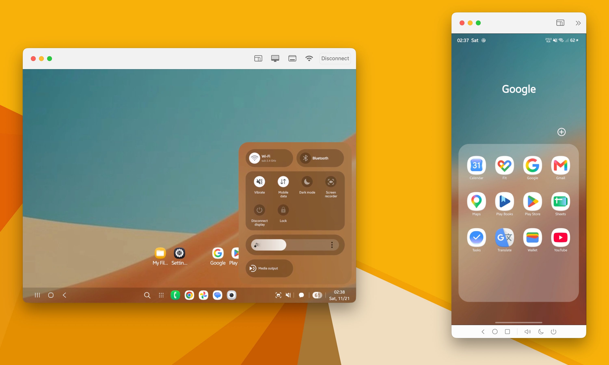

# MacDroid (`Android.app`)



A pure-Swift macOS 14+ app for wirelessly mirroring, controlling, and running Android Desktop Mode on your Mac over Wi-Fi — powered by `scrcpy-server` v3.1 with **no `adb` binary required**.

## Features

- **Wireless Debugging (Android 11+)**: Automatic Bonjour/mDNS discovery (`_adb-tls-connect._tcp` & `_adb-tls-pairing._tcp`), native TLS 1.3 + SPAKE2 pairing, and in-place `STLS` connection.
- **Phone & Desktop Mode**: Switch between mirroring your phone screen and launching an Android virtual desktop display (`1.5×` at `240 dpi`) sized to your Mac window.
- **Audio Routing**: Toggle between streaming phone audio to your Mac speakers (48 kHz stereo PCM) or playing directly from the phone.
- **Bidirectional Clipboard**: Copies on Android sync to your Mac clipboard; `Cmd+V` pastes your Mac clipboard into Android.
- **Full Mouse & Keyboard**: Click, drag, scroll, arrow keys, `Tab`, `Esc`, `Delete`/`Forward Delete`, `Home`/`End`/`PageUp`/`PageDown`, and `Cmd+C/V/X/A/Z`.
- **Drag-and-Drop**: Drop files onto the stream to save to `/sdcard/Download/`, or drop `.apk` files to auto-install.
- **Window & Screen Controls**:
  - **Fit Window**: Matches the viewport 1:1 to Android logical `dp` (`wm size` / `wm density`) in macOS points.
  - **Screen Off**: Turns off the phone's physical display while mirroring.
  - **Auto-Reconnect**: Remembers your last connected phone and reconnects automatically when it appears on Wi-Fi.

## Requirements

- macOS 14.0+ (Apple Silicon or Intel)
- Android 11+ phone with **Wireless Debugging** enabled on the same Wi-Fi network

## Build & Run

```bash
make deps   # Downloads scrcpy-server v3.1 into Sources/MacDroid/Resources/
make app    # Builds Android.app
make run    # Builds and opens Android.app
make test   # Runs unit tests
```

## Pairing & Connecting

1. On your Android phone, enable **Settings → Developer options → Wireless debugging**.
2. Open **Android.app** on your Mac and click **Wi-Fi** in the toolbar.
3. On your phone, tap **Pair device with pairing code** to get the IP, port, and 6-digit code.
4. Enter the pairing code in the **Pair** tab and click **Pair** (one-time setup; credentials are saved in `~/Library/Application Support/MacDroid/`).
5. Click **Connect** in the toolbar to start streaming.

## macOS Local Network Permission (`errno 65`)

macOS Sequoia/Tahoe requires **Local Network** permission for apps to connect to devices on your Wi-Fi network. If pairing or connecting fails with **`errno 65` (`No route to host`)** or no devices appear:

1. Open **System Settings → Privacy & Security → Local Network**.
2. Enable **Android** (if it is already enabled after a rebuild/re-sign, toggle it **off** and back **on**).
3. Quit and reopen **Android.app**.

## Architecture

- `WirelessADBScanner.swift` — Bonjour/mDNS discovery (`NWBrowser` + `NetService`).
- `ADBPairingClient.swift` — Native TLS 1.3 + SPAKE2 + AES-128-GCM pairing client (BoringSSL).
- `ADBTCPTransport.swift` / `ADBProtocol.swift` / `ADBRSAKey.swift` — Native ADB-over-Wi-Fi transport with `STLS` upgrade, `sync:` file push, `shell:`, and stream multiplexing.
- `ScrcpySession.swift` / `ScrcpyProtocol.swift` — `scrcpy-server` v3.1 session, video/audio/control streams, clipboard sync, and Android `dp` sizing.
- `VideoDecoder.swift` / `AudioPlayer.swift` / `DeviceStreamView.swift` — Hardware H.264 decoding (`AVSampleBufferDisplayLayer`), 48 kHz PCM audio (`AVAudioEngine`), input forwarding, and drag-and-drop.
